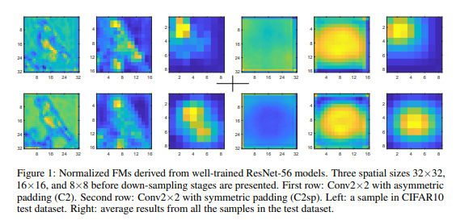
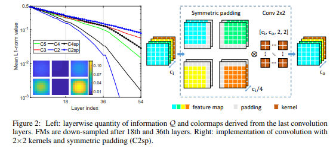
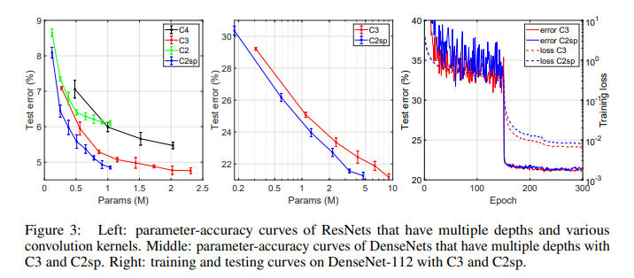

# Introduction

Convolution with even-sized kernels and symmetric padding

[paper](https://arxiv.org/pdf/1903.08385.pdf)

Shift Problem:

Asymmetric padding vs symmetric padding:

Training loss curve:

