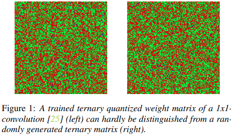
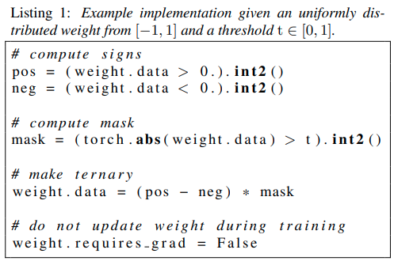

# Introduction

Compressing 1D Time-Channel Separable Convolutions using Sparse Random Ternary Matrices

[paper](https://arxiv.org/pdf/2103.17142.pdf)

Replace some 1x1 convolution with Sparse Random Ternary Matrices

Based on observation that 

force some weight to random sparse matrices:

Good summary on related work
